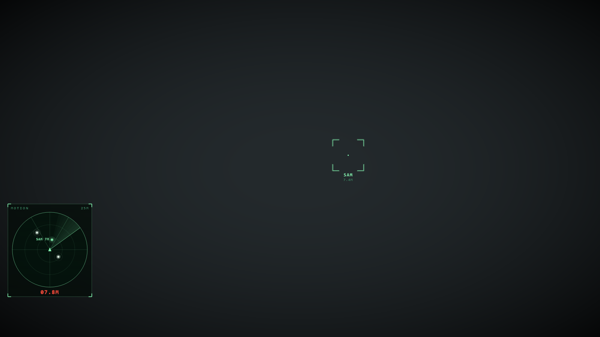
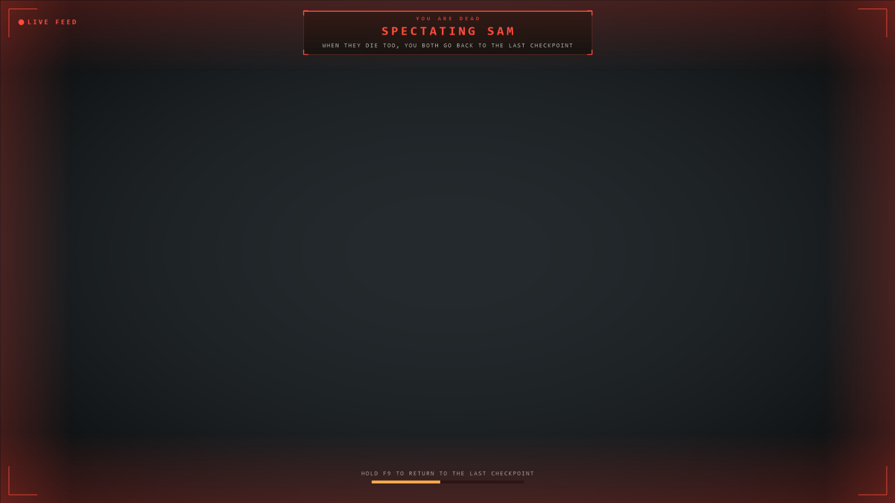

# Alien: Isolation co-op

A two-player co-op mod I'm making for *Alien: Isolation* (2014). Each player runs their own copy of the
campaign, and the mod mirrors what the other player does into your game: where they are, doors they open,
items and keycards they pick up, story steps they reach, and when they die.

It's still a prototype. A lot already works in game and a lot doesn't yet; the table below shows which is
which.

| In a level | When you die |
|---|---|
|  |  |

The overlay as it renders in game (shown here over a plain backdrop).

## Where it's at

I've only tested it on the Steam version (build 4940658), and so far mostly with two copies of the game on one
PC. I haven't played it across two PCs yet. My full test notes are in [docs/testing.md](docs/testing.md).

| Feature | State |
|---|---|
| Game boots with the mod, `AI.exe` untouched | works |
| Two copies on one PC | works |
| Co-op saves kept apart from your normal Steam Cloud saves | works |
| Achievements and stats blocked while modded | works (offline test) |
| Partner marker (name, distance, arrow when off-screen) | works |
| Host/join over Steam by Steam ID (no port forwarding) | works with the real Steam client, one account. Two accounts not tried yet |
| Host/join over UDP | works on one PC. Over the internet the host needs UDP 45500 open |
| Doors your partner opens open for you too | works |
| Items your partner picks up vanish from your world | works |
| Story steps your partner reaches run in your game | works for one tested step (M04 crowbar), not a whole mission |
| Dying: you watch through your partner's eyes until they die too, then both reload the checkpoint | works with real deaths in a level. Not yet tested with the alien doing the killing |
| Partner body: an NPC that walks where your partner walks, so the alien can see them | airport level only so far |
| Keycards and tools shared | written, not tried in a level yet |
| Host's alien director drives the joiner's alien (vents, behaviour, stage) | written, not tried in a level yet |
| One alien in the same place for both players | not done |
| New overlay: motion tracker, partner marker, death screens | tracker and marker checked in a level (airport, two copies on one PC); death screens only checked in rendered previews so far |
| Split screen on one PC through [Couchlink](https://github.com/cranebeaker/couchlink) | recipe written, seats tested by hand, not run inside Couchlink yet |
| Lobbies and Steam invites | planned, see [docs/online.md](docs/online.md) |

## Installing

1. Get `alien-isolation-coop.zip` from Releases (or build it, see below) and unzip it anywhere.
2. Close the game, then in the unzipped folder run
   `powershell -ExecutionPolicy Bypass -File install.ps1`.
   It finds the game through Steam, checks the version (other builds are refused unless you pass `-Force`),
   backs up `steam_api.dll`, and copies your saves into `coop_saves\default`. Your real saves aren't touched.
3. With Steam running, from the game folder:
   - Host: `play-coop.bat steam-host`. Your Steam ID shows in the top left of the game window and in
     `coop_logs\my_steam_id.txt`. Send it to your friend.
   - Friend: `play-coop.bat steam-join <host's Steam ID>`
   - Or direct IP: `play-coop.bat host` / `play-coop.bat join <host IP>`.
4. Both pick Continue Game. Your friend shows up as a green marker.

You each need your own copy of the game and your own Steam account. Play windowed or borderless; exclusive
fullscreen can hide the overlay.

To uninstall: `powershell -ExecutionPolicy Bypass -File install.ps1 -Uninstall`. That puts the original
`steam_api.dll` back. Co-op saves stay in `coop_saves`.

### Split screen (Couchlink)

1. Install the mod as above.
2. Add `couchlink\alien-isolation-coop.json` from the zip to Couchlink as a recipe.
3. Two players take a seat and press Play.

Seat 0 hosts, seat 1 joins it on the same PC. Each seat has its own saves (`coop_saves\seat<N>`), started from
a copy of `coop_saves\default`. One Steam account is enough here.

## How it plays

- **Motion tracker** in the bottom left. Anything that moved in the last second within 25 m shows up, your
  partner in green. Pings speed up as something gets closer, and under 6 m you hear a heartbeat.
- **Dying.** Your screen switches to your partner's view with "SPECTATING <name>" at the top. They get a sting,
  a red flash and a warning that you're down. Once they die too, both games load the last checkpoint. If they
  drop out you go back after 10 seconds, or hold F9 for 2 seconds to go back on your own.
- **One director.** The host's game decides when the alien comes out and when it retreats, and the joiner's
  alien follows.
- All sounds are generated by the mod. `AIC_SFX=0` turns them off.

## Known issues

- The partner marker is an overlay, so you can see it through walls. The 3D body only exists in the airport
  level for now.
- Each game still has its own alien. They follow the same director decisions but hunt on their own between them.
- Hacking, lifts, cutscenes and anything else a mission does outside doors, items, keycards and story steps
  isn't synced, so long sessions can drift. Start from the same save.
- Only deaths that go through the game's normal death script are caught. If one slips through you just get
  the regular game-over menu (look for `life: player died` in the log).
- Spectating updates 20 times a second, so fast turns look a bit stepped. You don't see your partner's HUD.
- UDP mode has no NAT punching; use Steam mode over the internet.
- Two copies on one Steam account can't reach each other over Steam, so local testing uses UDP.
- Fullscreen copies minimise when they lose focus.
- A new profile starts with the brightness screen.

## How it works

`steamwrap/` builds a stand-in `steam_api.dll`. It passes every call through to the real one (renamed
`steam_api_real.dll`), points cloud saves at `coop_saves\<profile>\`, swallows achievement and stat writes,
lets two copies run side by side (`AIC_PROFILE`), and loads `coopnet.dll`.

`coopnet/` is the co-op part:

- **Position.** It reads the player camera each frame (`[exe+0x12F0C88]+0x58`, record at `+0x78C`) and sends
  position and rotation 20 times a second, over UDP or Steam P2P (`ISteamNetworking005`, channel 7).
- **World sync.** Cathode runs level scripts as messages ("run method M on entity E"), and every entity has a
  path of IDs from the level files that's the same on both PCs. coopnet hooks `EntityManager::call_method`
  (RVA 0x526680), watches for a handful of messages, and replays them on the other side:

  | You do this | Your partner's game does this |
  |---|---|
  | a `Door_Package` sets `IsOpen` | `request_open` on the same door (locked doors stay locked) |
  | a pickup sets its "collected" value | the load-time "already taken" path, which hides the item |
  | a `LogicOnce` in one of the 35 story mission composites fires | the same `LogicOnce`, and their mission script carries on |
  | `SetPlayerHasKeycard` / `SetPlayerHasGatingTool` | the same, so they get the card or tool |
  | (host only) `NPC_WithdrawAlien`, `NPC_AlienConfig`, `NPC_SetAlienDevelopmentStage` | the same on their alien |

  Only these methods are accepted from the network, and nothing received gets sent back. `AIC_SYNC=0` turns it off.
- **Death.** It catches `TriggerDeath` on the player's `Health_Damage_Death` script. While you're spectating it
  holds back the game-over menu (a vtable hook at exe `0x1300224`), the fade and the death blur, and writes your
  partner's camera into the death camera's records so your game renders their view. When both are down it shows
  the menu and picks Load Current Save. The rules are in `coopnet/life.c` and tested offline.
- **Partner body.** The engine won't spawn characters added through the level files, so the body is an NPC the
  level already has (in the airport, `scared_civvie_01`). `tools/levelmod drivenpc` adds a position marker, a
  go-to command and a short loop next to it. coopnet (`puppet.c`) spawns the NPC where your partner is and keeps
  moving the marker to their feet.

Settings are environment variables: `AIC_COOP_MODE` (`host`, `join`, `steam-host`, `steam-join`),
`AIC_COOP_PEER`, `AIC_COOP_PEER_STEAM`, `AIC_COOP_PORT`, `AIC_COOP_NAME`, `AIC_PROFILE`, `AIC_COUCH_SEAT`,
`AIC_SEED_SAVES`, `AIC_SFX`, `AIC_SYNC`, `AIC_SPECTATE_CAM`, `AIC_HOLD_MENU`, `AIC_DEATH_NOFADE`, and the
experimental `AIC_ALIEN_TAG` / `AIC_ALIEN_PIN`. For testing: `AIC_SPECTATE_TEST=1`, `AIC_LIFE_TEST=<seconds>`.

## Building

Needs [Zig 0.16.0](https://ziglang.org/download/).

```powershell
.\build.ps1 -Zig C:\path\to\zig.exe
```

That builds both DLLs, runs the offline tests and writes `build\alien-isolation-coop.zip` with
`build\SHA256SUMS.txt`.

To try a build without the installer, copy the whole game folder somewhere else first (don't use your real
install). In the copy, rename `steam_api.dll` to `steam_api_real.dll`, drop in `build\steam_api.dll`, add a
`steam_appid.txt` containing `214490`, then start it with `$env:AIC_PROFILE="p1"; .\AI.exe` (and `p2` for a
second copy). Logs go to `coop_logs\`.

## What I'm working on next

1. Partner body in every level, set up by the installer on your own (backed-up) level files.
2. One shared alien: the host's alien hunts both players, the joiner's alien copies its position, and a kill on
   the joiner's body counts as the joiner's death. Survivor Mode first, since the alien is out from the start.
3. A death by the alien, then a full mission with two players.
4. Two PCs, two Steam accounts.
5. Run the recipe inside Couchlink.
6. Lobbies and invites ([docs/online.md](docs/online.md)).
7. More world sync: hacking, lifts, terminals, cutscenes.

## Credits

- [CathodeLib](https://github.com/OpenCAGE/CathodeLib) by Matt Filer, used by `levelmod` to read and patch
  level scripts.
- Steam interface slot order from the Steamworks headers in the
  [Goldberg emulator](https://gitlab.com/Mr_Goldberg/goldberg_emulator).
- [Couchlink](https://github.com/cranebeaker/couchlink) for split screen on one PC.
- Thanks to the modders whose public notes on the engine (the camera pointer chain and the script call
  layout) gave me a head start.

No game files are included; you need your own copy of the game.

MIT licensed, see [LICENSE](LICENSE).
