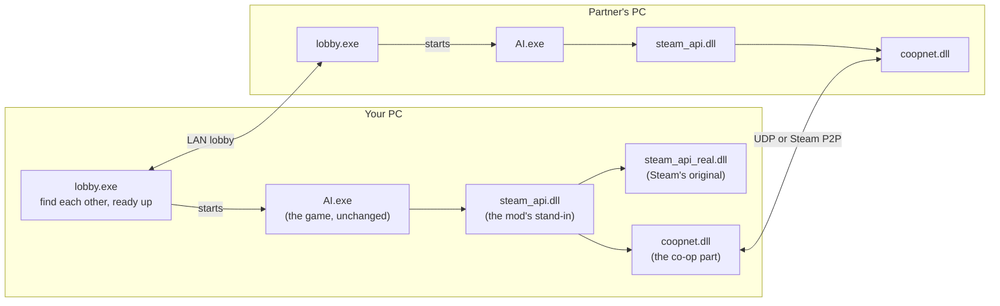
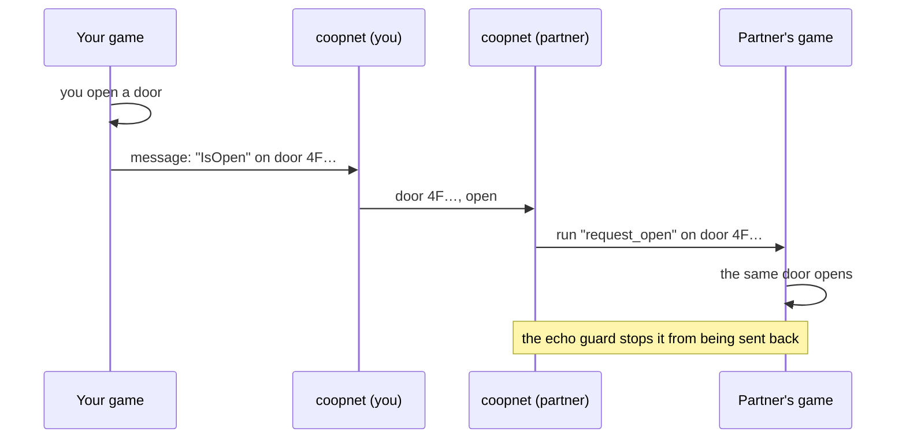
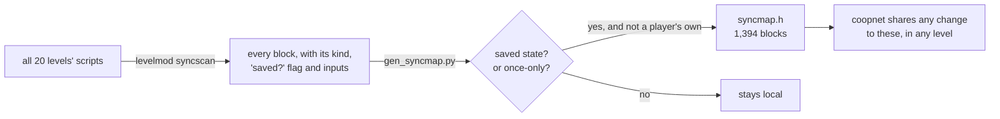
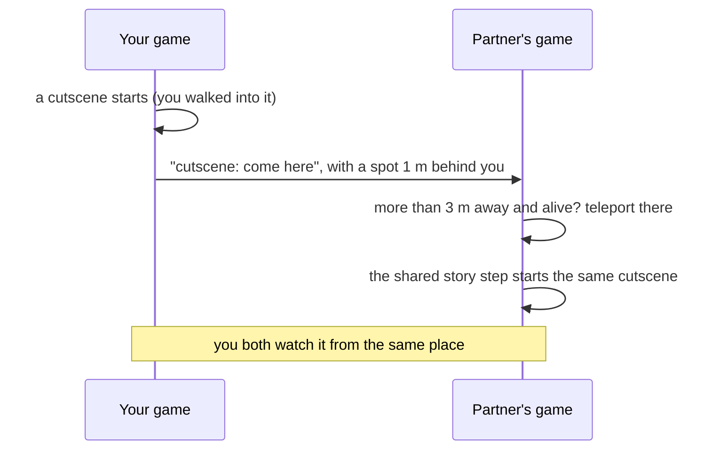
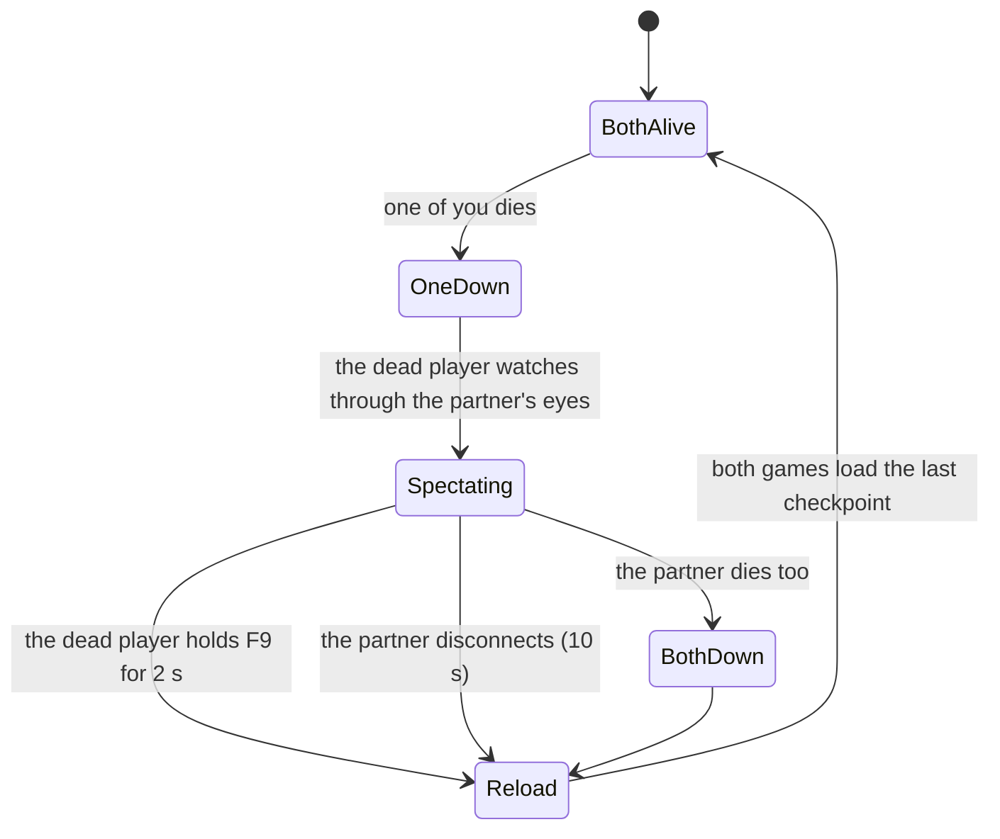
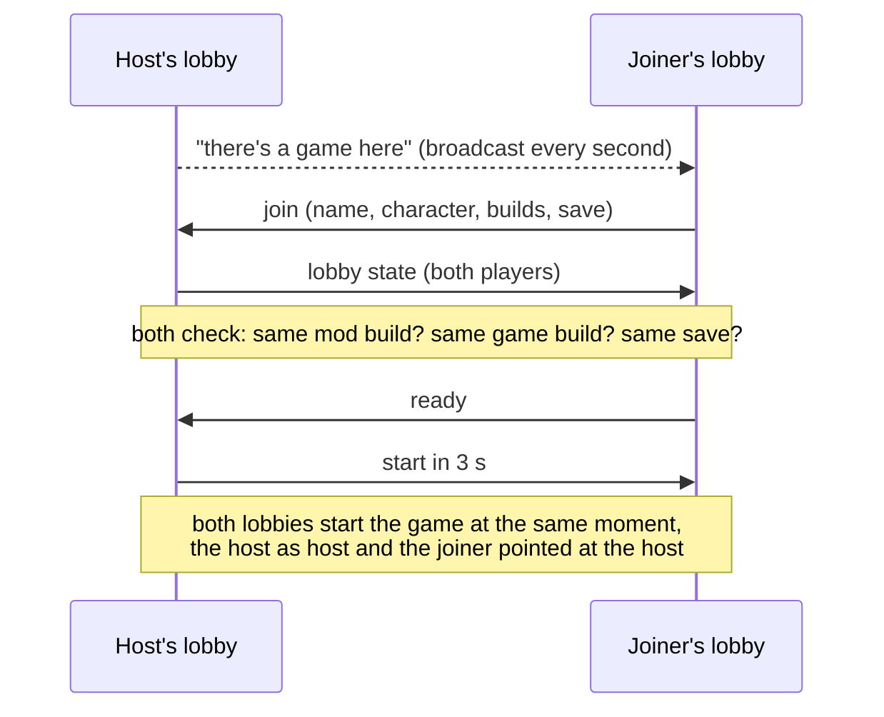

# How the mod works

*Alien: Isolation* is a single-player game, so there's no multiplayer code in it to switch on. Each of you runs
your own full copy of the campaign. The mod watches what happens in your game, sends the parts that matter to
your partner, and makes the same things happen in their game. Two separate games that agree with each other
feel like one shared world.

This page explains each part in plain terms. The README's [How it works](../README.md#how-it-works) section has
the engine addresses and file names.

## The pieces

- **The game itself is never modified.** The game loads `steam_api.dll` at start. The mod puts its own
  `steam_api.dll` there, which passes every Steam call through to the real one (kept as `steam_api_real.dll`) and
  loads `coopnet.dll`.
- **`coopnet.dll`** is the co-op part: it reads what's happening in your game, talks to your partner's copy, and
  draws the overlay.
- **`lobby.exe`** is the launcher. It finds your partner and checks you're set up the same, then starts both games.

## What gets sent between you

| What | How often | Why |
|---|---|---|
| Where you are and where you're looking | 20 times a second | marker, tracker, partner body, spectating |
| Something you did to the world (a door, an item, a story step...) | when it happens, sent 3 times | so it happens in their game too |
| Alive, dying, dead, spectating | every half second and on every change | the co-op death rules |
| Where your alien is | 30 times a second | tracker, bio-monitor, shared alien |
| The host's alien in full: facing, speed, in the vents, its setup, what it has learned, your body's deaths | 30 times a second (shared alien only) | the joiner's alien copies it |
| "A script just moved me from here to there" | when it happens, sent 3 times | lift rides together |
| Which character you want to be seen as | every 2 seconds | skins |

Every message carries a version and a checksum; anything else is dropped. It's all small: well under 10 KB a
second.

## Seeing your partner

- **Marker and motion tracker.** Your partner's position goes into an overlay drawn over the game: a marker with
  their name and distance, and a motion tracker in the corner like the one Ripley carries. It shows anything that
  moved recently within 25 m, with your partner in green.
- **A body in the world.** The alien can only hunt what's in the game, so the mod also puts a character where
  your partner is. Two ways:
  - **Skins (experimental):** the mod asks the game to spawn a story character (Taylor, Samuels, Axel...), the same
    way the game spawns its own characters, then keeps moving that character to wherever your partner stands.
    The level must already contain that character's model.
  - **Puppet (airport only, the older way):** an extra character the level already has is steered to your
    partner's position by a small addition to the level script.

## Sharing the world

The game runs each level from scripts made of small building blocks: a door has an "open" input, an item has a
"collected" flag, a mission has steps that fire once. When something happens, the game sends a message like
"run *open* on *this door*". Every block has an ID from the level files, and the IDs are the same on every PC.

The mod watches those messages. When it sees one of a short list it knows how to share, it sends the message's
target and action to your partner, and their game runs the same action on the same block:

What's shared:

| In your game | In your partner's game |
|---|---|
| you open a door | the same door opens (and closes again like normal) |
| you unlock a door: hacking, a keycard, a code, a lever, a button | that door is unlocked for them too |
| you cut a door open with the torch | it's open for them too |
| you pick up an item | it disappears from their world (they don't get a copy) |
| you pick up a keycard or a tool | they get it too |
| you reach a story step | their mission script moves to the same step |
| you take a lift, tram or exit to another level | they load the same level |
| (host only) the alien comes out, retreats or changes behaviour | their alien does the same |

### Automatic: no rule per door, story step or puzzle

The table above covers the few things that need translating (opening a door, hiding a picked-up item). Everything
else is found automatically from the level files, by asking two questions about every block in every level:

1. **Does the game save it?** Blocks marked "persistent" hold the world's state: a door cut open, a generator
   switched on, a puzzle solved, a story flag. When one changes in your game, it's set the same way in your
   partner's. Setting something that's already set does nothing, so it can't go wrong twice.
2. **Can it only ever happen once?** Mission and level scripts put every one-time step behind a *once* gate:
   story progress, the start of a cutscene, a scripted event, a puzzle finishing. When one fires in your game it
   fires in your partner's, and their script carries on from there. A once gate can't fire twice, so nothing
   doubles up. Things that repeat (music, lights, hint boxes) don't use these gates, so they stay with each player.

Blocks that belong to one player rather than the world are left out: thrown items, weapons, cameras, NPC brains,
the UI and hiding in lockers.

That gives 135 saved-state blocks and 1,259 once-only steps across the game, between about 30 and 260 in each
level. Nobody wrote a rule for any of them, and a game update or another level would be picked up by running the
generator again.

**Story progress and cutscenes** work through the once gates: firing the same gate in your partner's game moves
their mission forward without doing anything twice.

The hand-written rules work in every level too: doors, locks, items, keycards, tools and level exits are built
from the same shared blocks, with the same IDs in every level (the check is in [testing.md](testing.md)). The two
LV426 levels use their own doors, so the door-opening rule doesn't reach them.

**Only these actions are accepted from the network**, so a partner (or anyone else) can't make your game run
arbitrary script.

## Cutscenes: you watch them together

When a cutscene starts in your game, your partner is moved to you at that moment, so you both watch it and carry on
from the same place. Their screen shows *CUTSCENE: JOINING &lt;your name&gt;* for a few seconds.

- **What counts as a cutscene** comes from the level files again: anything starting inside one of the game's 14
  cutscene scripts (where all of its cutscene camera animations are), and the 11 moments where a story mission
  takes over your camera. Camera moves that belong to one player (hacking, hiding) don't count.
- **Where they land:** a spot you walked through a moment ago, about a metre behind you. A player fits there,
  it's not inside a wall, and it's not inside your body.
- **When they don't move:** if they're already within 3 m of you, dead and spectating, or not in a level.
- **If you both start one at once,** the joiner goes to the host.
- **Who started it:** only the game where the cutscene began sends the request. When the same cutscene then starts
  in your partner's game because the story step was shared, that one doesn't pull you back.
- The move uses the game's own character teleport, on the game's own thread, and only after checking that this
  build of the game has it where the mod expects. `AIC_CUTSCENE_TP=0` turns this off.

## Regroup: hold F7

Got separated, or stuck somewhere? Hold **F7** for a second and a half and you're moved to your partner. Your
game asks theirs for a landing spot (a point they walked through a moment ago, about a metre behind them), the
screen fades to black, you're moved, and it fades back in. It doesn't work while you're dead, outside a level or
already next to them, and you can do it once every 10 seconds. Your partner sees *REGROUP: &lt;you&gt; IS COMING TO
YOU*.

## Same builds or no world sync

Every few seconds each game tells the other which builds it runs: a fingerprint of the mod and of the game's
`AI.exe`. If they differ, replaying script messages between the two games isn't safe, so world sync stops on both
sides and the overlay says *DIFFERENT MOD BUILD* (or game build). Everything else (seeing each other, the tracker,
dying together) keeps working. The lobby makes the same check before you start.

## The alien

- **One director.** The host's game decides when the alien comes out of the vents, when it retreats and how
  aggressive it is. Those decisions are sent to the joiner's game, whose alien follows them. The joiner's game
  never sends its own.
- **Shared alien (experimental).** The host's alien is the real one: it thinks, hunts and kills as in the
  single-player game, and it sees the joiner's body like any other target. The joiner's alien is a copy:
  - Its behaviour tree doesn't run, so it never decides anything of its own.
  - Every frame it gets the game's own "move this way" order towards where the host's alien is, at the same
    speed, so it walks, runs and turns with its own animations (the method is OpenCAGE's "possess a character").
    When it's there it stops and turns to the host's alien's facing. More than 3 m off, a floor up or down, or in
    the vents, it's put on the spot instead.
  - Its alien setup and what the game has let it learn (its tricks, and the counters that unlock them) are set to
    the host's.
  - When the host's alien kills the joiner's body, the joiner dies in their own game, with the game's own kill.
  - On the host, the joiner running near the alien makes noise it hears, as the player's own running would.

  Its attacks and kill animations still only play in the host's game.

## Dying together

When you die, the mod holds back the game-over screen and shows your partner's view instead. Your partner gets a
sting, a red flash and a warning. When they die too, both games load the last checkpoint together. You can give
up early by holding F9.

## Saves

Co-op progress goes into its own folder, `coop_saves`, and never touches your normal Steam Cloud saves. The
installer starts you off with a copy of your current saves.

Because each of you runs your own campaign, you need to start from the same save. The lobby checks this for you:
it compares a fingerprint of both save folders. If they differ, the joiner can copy the host's save across the
network with one button. Their own save is moved to `coop_saves\backup\` first.

## The lobby

If the game doesn't show up on the joiner's list (VPN LANs often block broadcasts), type the host's address
under *Join by address*.

Over the internet, the *Internet* tab does the same with a Steam lobby. The host creates a friends-only lobby;
friends see "hosting co-op" next to the host's name and press Join, or the host invites them. The joiner's lobby
then asks the host's for its "there's a game here" over Steam, and from there it's the same conversation as above,
carried by Steam instead of the LAN, including the save copy. On Start both lobby windows let go of Steam and the
games connect to each other over Steam. Details in [online.md](online.md).

## Skins

Each skin is a story character the game already has. When the mod spawns your partner's body, it fills in the
same kind of spawn request the game uses for its own characters (the request layout comes from AI-MP by
Dropper7856), naming the character's model, skeleton and animations. Then it keeps that character where your
partner is. See the [skin cards](../README.md#skins-experimental) for which characters exist and where.

A level can only show a character whose model it contains, and out of the box most characters are in one to
four levels. The game also checks some of its data files against a built-in table of sizes and hashes, and quits
without a word when one differs; a level with characters added fails it. coopnet waives that check in memory, and
only for files skinprep changed (OpenCAGE does the same by patching AI.exe on disk; the mod never changes AI.exe). `install.ps1 -Skins` copies the five main characters into every level (`tools/skinprep`). The scripts,
materials, textures and the rest are written with CathodeLib, but the two model files are written by skinprep's
own `ModelAppend.cs`, because CathodeLib's model writer produced files the game couldn't load (found in in-game
testing; details in [testing.md](testing.md)). It keeps the level's model files byte for byte and adds each new
model at the end: the model's records and data are copied raw from the level it comes from, and only the numbers
that point at other things change (names, the next submesh and LOD, material, collision, morphs, vertex formats,
bones). Then every file the level's scripts point at is checked to point at the new model.

## What it doesn't do (yet)

- Things that can happen again and again (using a terminal twice, music and light zones) aren't shared; only
  saved state and once-only steps are. Start from the same save.
- Lift rides: when a script moves you in one go (a lift between floors), your partner's game is told where from
  and where to, and if they were standing within 3 m of where you left, they're moved by the same amount. Nothing
  about lifts is known to the mod, so it works for any scripted move. Each game's lift doors and cab still run on
  their own.
- Your partner's body walks by being moved, not by playing walking animations.
- The shared alien's attacks and kills only play in the host's game.
- The newest parts (the shared alien, carry-along, the new `-Skins` levels, Steam lobbies, cutscene teleport,
  lock and level-change sync) haven't been run in the game yet. [testing.md](testing.md) lists what has.
