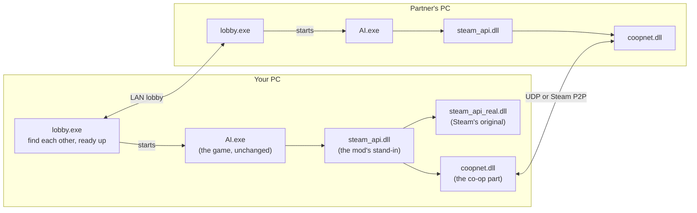
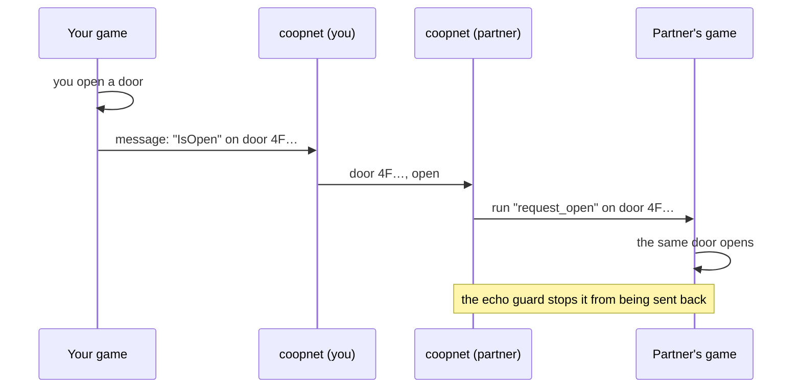
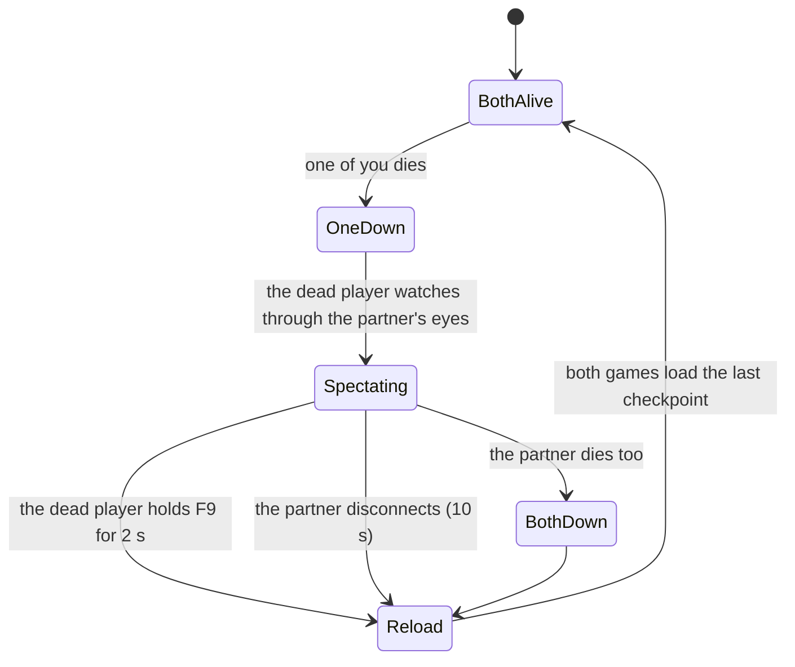
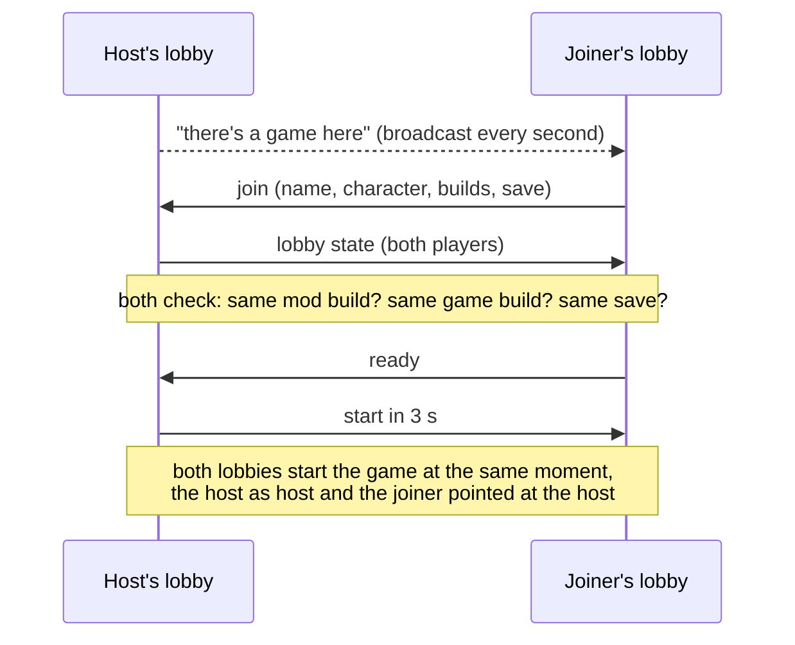

# How the mod works

*Alien: Isolation* is a single-player game, so there's no multiplayer code in it to switch on. Each of you runs
your own full copy of the campaign. The mod watches what happens in your game, sends the parts that matter to
your partner, and makes the same things happen in their game. Two separate games that agree with each other
feel like one shared world.

This page explains each part in plain terms. The README's [How it works](../README.md#how-it-works) section has
the engine addresses and file names.

## The pieces

- **The game itself is never modified.** The game loads `steam_api.dll` at start. The mod puts its own
  `steam_api.dll` there, which passes every Steam call through to the real one (kept as `steam_api_real.dll`) and
  loads `coopnet.dll`.
- **`coopnet.dll`** is the co-op part: it reads what's happening in your game, talks to your partner's copy, and
  draws the overlay.
- **`lobby.exe`** is the launcher. It finds your partner and checks you're set up the same, then starts both games.
- **`skinprep`** (optional, run by the installer with `-Skins`) adds character models to the level files so your
  partner can show up as a character everywhere.

## What gets sent between you

| What | How often | Why |
|---|---|---|
| Where you are and where you're looking | 20 times a second | marker, tracker, partner body, spectating |
| Something you did to the world (a door, an item, a story step...) | when it happens, sent 3 times | so it happens in their game too |
| Alive, dying, dead, spectating | every half second and on every change | the co-op death rules |
| Where your alien is | 10 times a second | tracker, bio-monitor, shared alien |
| Which character you want to be seen as | every 2 seconds | skins |

Every message carries a version and a checksum; anything else is dropped. It's all small: well under 10 KB a
second.

## Seeing your partner

- **Marker and motion tracker.** Your partner's position goes into an overlay drawn over the game: a marker with
  their name and distance, and a motion tracker in the corner like the one Ripley carries. It shows anything that
  moved recently within 25 m, with your partner in green.
- **A body in the world.** The alien can only hunt what's in the game, so the mod also puts a character where
  your partner is. Two ways:
  - **Skins (experimental):** the mod asks the game to spawn a story character (Taylor, Samuels, Axel...), the same
    way the game spawns its own characters, then keeps moving that character to wherever your partner stands.
    The level must contain that character's model, which is what `skinprep` adds.
  - **Puppet (airport only, the older way):** an extra character the level already has is steered to your
    partner's position by a small addition to the level script.

## Sharing the world

The game runs each level from scripts made of small building blocks: a door has an "open" input, an item has a
"collected" flag, a mission has steps that fire once. When something happens, the game sends a message like
"run *open* on *this door*". Every block has an ID from the level files, and the IDs are the same on every PC.

The mod watches those messages. When it sees one of a short list it knows how to share, it sends the message's
target and action to your partner, and their game runs the same action on the same block:

What's shared:

| In your game | In your partner's game |
|---|---|
| you open a door | the same door opens (and closes again like normal) |
| you unlock a door: hacking, a keycard, a code, a lever, a button | that door is unlocked for them too |
| you cut a door open with the torch | it's open for them too |
| you pick up an item | it disappears from their world (they don't get a copy) |
| you pick up a keycard or a tool | they get it too |
| you reach a story step | their mission script moves to the same step |
| you take a lift, tram or exit to another level | they load the same level |
| (host only) the alien comes out, retreats or changes behaviour | their alien does the same |

**Why this works in every level:** doors, locks, items, keycards, tools and level exits are all built from the
same shared blocks, with the same IDs in every level. I checked all 20 levels' files (the table is in
[testing.md](testing.md)). The two LV426 levels use their own doors, so door sync doesn't reach them.

**Story progress** works because mission scripts gate each step behind a block that can only fire once. Firing the
same one in your partner's game moves their mission forward without doing anything twice.

**Only these actions are accepted from the network**, so a partner (or anyone else) can't make your game run
arbitrary script.

## The alien

- **One director.** The host's game decides when the alien comes out of the vents, when it retreats and how
  aggressive it is. Those decisions are sent to the joiner's game, whose alien follows them. The joiner's game
  never sends its own.
- **Shared alien (experimental).** Each game still has its own alien. In experimental mode, the joiner's alien is
  moved to where the host's alien is whenever they get more than 4 m apart, so you both deal with the alien in
  the same place. In between it hunts on its own.

## Dying together

When you die, the mod holds back the game-over screen and shows your partner's view instead. Your partner gets a
sting, a red flash and a warning. When they die too, both games load the last checkpoint together. You can give
up early by holding F9.

## Saves

Co-op progress goes into its own folder, `coop_saves`, and never touches your normal Steam Cloud saves. The
installer starts you off with a copy of your current saves.

Because each of you runs your own campaign, you need to start from the same save. The lobby checks this for you:
it compares a fingerprint of both save folders. If they differ, the joiner can copy the host's save across the
network with one button. Their own save is moved to `coop_saves\backup\` first.

## The lobby

If the game doesn't show up on the joiner's list (VPN LANs often block broadcasts), type the host's address
under *Join by address*. The lobby is LAN only for now; Steam lobbies are next.

## Skins

Each skin is a story character the game already has. When the mod spawns your partner's body, it fills in the
same kind of spawn request the game uses for its own characters (the request layout comes from AI-MP by
Dropper7856), naming the character's model, skeleton and animations. Then it keeps that character where your
partner is. See the [skin cards](../README.md#skins-experimental) for which characters exist and where.

A level can only show a character whose model it contains. Out of the box most characters are in one to four
levels. `install.ps1 -Skins` runs `skinprep`, which copies the five main characters' models, and everything
they're drawn with, into every level. It backs up the originals first; uninstalling puts them back.

## What it doesn't do (yet)

- Cutscenes, computer terminals, rewiring panels and lift rides inside a level aren't shared, so long sessions
  can drift apart. Start from the same save.
- Your partner's body walks by being moved, not by playing walking animations.
- Each game still has its own alien; experimental mode only keeps the joiner's near the host's.
- The newest parts (skins in game, shared alien, lock and level-change sync, starting from the lobby) haven't been
  run in the game yet. [testing.md](testing.md) lists what has.
